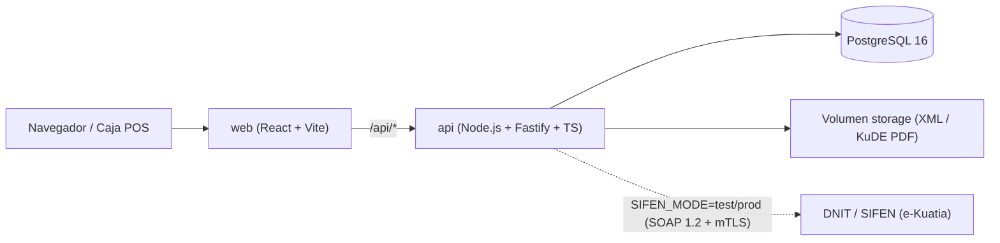
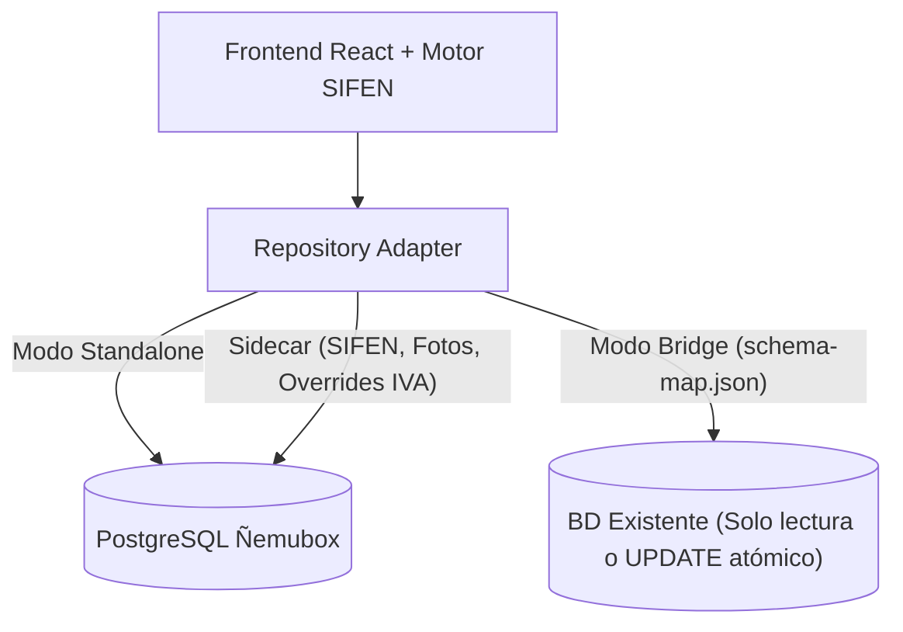

# Arquitectura Técnica — Ñemubox

## 1. Visión general

`Ñemubox` está diseñado como un monorepo simple pensado para correr en una PC local, mini-PC o VPS mediante Docker Compose, minimizando la fricción operativa para comercios en Paraguay.

## 2. Modelo de datos (PostgreSQL + Prisma)

El esquema definido en `api/prisma/schema.prisma` cubre de entrada los requerimientos fiscales paraguayos:

- **`EmitterConfig`**: datos fiscales del contribuyente emisor (RUC, DV, razón social, timbrado, establecimiento, punto de expedición, numerador correlativo, modo SIFEN y CSC).
- **`Customer`**: receptores (Consumidor Final o contribuyentes con RUC + DV para facturación).
- **`Product`**: catálogo de productos con SKU, código de barras, unidad de medida (con código SIFEN, ej. `77` = Unidad), precio/costo en Guaraníes (`PYG`), tasa de IVA paraguayo (`IVA_10`, `IVA_5`, `EXENTA`), stock actual y stock mínimo.
- **`ProductImage`**: relación 1:1 separada de `products` que almacena la foto optimizada o ícono SVG (`BYTEA`) directamente en PostgreSQL sin penalizar el listado del catálogo.
- **`StockMovement`**: Kardex auditable de cada entrada, salida, venta, devolución o ajuste manual (guarda `previousStock` y `newStock`).
- **`Sale` y `SaleItem`**: registro comercial de la venta con desglose de subtotales e IVA 10% / 5% / Exenta y condición de pago (`CONTADO` / `CREDITO`).
- **`SifenDocument`**: Documento Electrónico (DE) vinculado a una venta: CDC de 44 dígitos, numeración `EST-PEXP-NUMERO`, estado del ciclo de vida (`DRAFT` -> `SIGNED` -> `QUEUED` -> `SENT` -> `APPROVED` / `REJECTED` / `CANCELLED`), XML generado/firmado, URL de QR y respuesta DNIT.
- **`SifenBatch`**: lotes asíncronos (hasta 50 DEs por envío, según Manual Técnico SIFEN v150) para no bloquear la caja durante la emisión.

## 3. Modo Bridge / Metamórfico (Fase 4 — BD Existente + Sidecar)

Para comercios que ya poseen una base de datos heredada y no quieren migrar su sistema anterior:

- **Introspección segura**: consulta `information_schema` y valida todas las tablas/columnas contra lista blanca antes de construir consultas parametrizadas.
- **Cero `ALTER TABLE`**: las tablas originales del negocio nunca se alteran; todo lo nuevo de SIFEN, fotos y overrides vive en el PostgreSQL sidecar de Ñemubox.
- **3 opciones operativas**: `Standalone` (con opción segura de limpiar datos demo), `Bridge` (en vivo) o `Importación única` desde la BD externa hacia Standalone.

## 4. Estrategia de red (Fase 6)

Para adaptarse a la realidad de los ISPs en Paraguay (donde el CGNAT es frecuente):

1. **Sin abrir puertos (recomendado bajo CGNAT):** servicio opcional `cloudflared` (Cloudflare Tunnel) en `docker-compose.yml` con perfil `--profile tunnel`.
2. **Con IP pública real:** reverse proxy **Caddy** exponiendo únicamente el puerto `443` (TLS automático) + actualizador DDNS. El puerto `5432` de PostgreSQL permanece siempre ligado a `127.0.0.1` o a la red interna de Docker.
