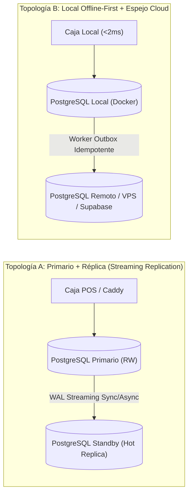

# Feature Spec: Modo HA (Alta Disponibilidad y Sincronización de Bases de Datos)

- **Estado:** Propuesto / Planificado
- **Rama objetivo:** `feat/07-ha-db-sync`
- **Prioridad:** Alta (continuidad operativa de caja POS y resguardo fiscal SIFEN)

---

## 1. Problema que resuelve

En comercios y PyMEs de Paraguay, una caída de Internet (ISP), un corte de energía o una falla de disco en la PC principal no debería frenar las ventas ni poner en riesgo el histórico de stock, Kardex y Documentos Electrónicos (XML / CDC / KuDE) exigidos por la DNIT.

El **Modo HA** busca que **Ñemubox** pueda operar con **dos o más bases de datos PostgreSQL sincronizadas**, manteniendo continuidad en la caja y recuperación rápida ante fallas, sin exigir infraestructura compleja como Kubernetes.

---

## 2. Topologías soportadas

### Topología A — Primario + Réplica en caliente (LAN o VPS)
Pensada para comercios con 2 equipos (o PC local + VPS unido por WireGuard/Tailscale):
- **PostgreSQL Streaming Replication (WAL)** entre un nodo `primary` (lectura/escritura) y un nodo `standby` (réplica en caliente en tiempo real).
- Monitor de salud (`ha-watchdog`) que mide el **lag de replicación** en milisegundos/bytes y expone alertas en la interfaz de Ñemubox.
- **Failover asistido o automático**: promoción controlada del nodo `standby` (`pg_promote()`) y redirección del reverse proxy **Caddy** si el primario cae.

### Topología B — Local Offline-First + Espejo en la Nube (Sync Asíncrona)
Pensada para sucursales o negocios con Internet inestable:
- La caja trabaja siempre contra el **PostgreSQL local en Docker** (latencia mínima, sigue facturando incluso sin Internet).
- Un **Worker de Sincronización** basado en patrón **Outbox** (`sync_outbox`) replica en segundo plano los eventos confirmados (ventas, movimientos Kardex, productos, fotos y `sifen_documents`) hacia una BD espejo en la nube (VPS o Supabase).
- Al restaurarse Internet, vacía la cola pendiente de forma ordenada e idempotente y despacha los lotes SIFEN pendientes.

---

## 3. Reglas críticas de integridad (SIFEN y Stock)

Para evitar corrupción de datos o conflictos de *split-brain* al sincronizar dos nodos:

1. **Numeración fiscal aislada por Punto de Expedición**:
   - Cada nodo capaz de emitir facturas debe tener asignado su propio `puntoExpedicion` único (ej. Nodo 1 = `001-001`, Nodo 2 = `001-002`).
   - Esto garantiza **cero colisiones de correlativos ni CDC duplicados** aunque ambos nodos operen momentáneamente desconectados.
2. **Stock sincronizado por deltas (Kardex), nunca por sobrescritura**:
   - La replicación lógica/Outbox aplica deltas de `stock_movements` (`-2`, `+10`) usando IDs determinísticos (`cuid`/UUID) en lugar de pisar el saldo final, evitando perder ventas concurrentes.
3. **Idempotencia estricta**:
   - Todo evento sincronizado lleva `eventId`, `nodeId` y `checksum`; reintentar un envío nunca duplica una venta, un movimiento de stock ni un DE SIFEN.
4. **Respaldo de archivos XML / KuDE**:
   - Como el XML firmado y el QR viven ya en columnas de PostgreSQL (`sifen_documents`), replicar la BD resguarda automáticamente todos los comprobantes fiscales sin depender solo del disco local.

---

## 4. Entregables planificados (`feat/07-ha-db-sync`)

### Infraestructura y Base de Datos
- [ ] Perfil `docker-compose.ha.yml` (`--profile ha`) con `postgres-primary`, `postgres-replica` (replicación WAL lista de fábrica) y `ha-monitor`.
- [ ] Tabla `sync_outbox` y `ha_node_status` en `api/prisma/schema.prisma` para trazabilidad de nodos, heartbeat y cola de replicación.
- [ ] Job de backups automáticos (`pg_dump` comprimido + rotación por días) configurable por `.env`.

### Backend (`api/`)
- [ ] `GET /api/ha/status`: rol del nodo (`PRIMARY` / `REPLICA` / `STANDALONE`), lag de replicación, estado de conexión al nodo par y eventos pendientes en Outbox.
- [ ] `POST /api/ha/sync-now`: fuerza un ciclo inmediato de sincronización hacia el nodo espejo.
- [ ] `POST /api/ha/promote`: promoción controlada (protegida con confirmación explícita) en caso de caída del nodo primario.
- [ ] Worker de Outbox con reintentos exponenciales (backoff) y detección de conflictos.

### Frontend (`web/`)
- [ ] Nueva pestaña **Configuración → Alta Disponibilidad (HA)**:
  - Semáforo en vivo de ambos nodos (Primario / Espejo), lag en segundos y cola pendiente.
  - Configuración de `nodeId` y `puntoExpedicion` exclusivo por nodo.
  - Botón de sincronización manual, descarga de backup completo y guía rápida de failover.

---

## 5. Criterios de aceptación

- Una venta emitida en el nodo primario aparece replicada en el nodo secundario en `< 2s` con conexión estable.
- Si se desconecta el nodo secundario o Internet, la Caja POS sigue vendiendo y emitiendo sin degradación; al reconectar, todos los movimientos y DEs se sincronizan sin duplicados ni pérdida de stock.
- Dos nodos operando en paralelo con puntos de expedición distintos (`001` y `002`) nunca generan el mismo número de factura ni CDC.
